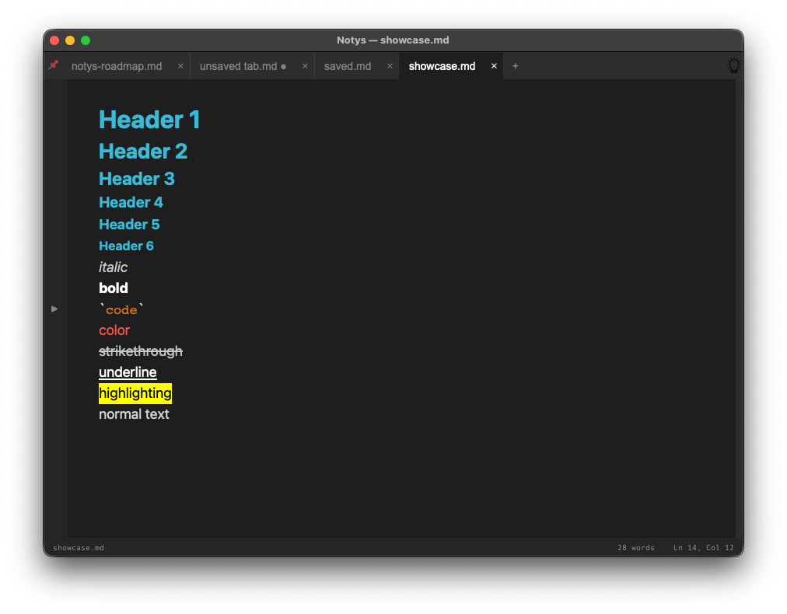
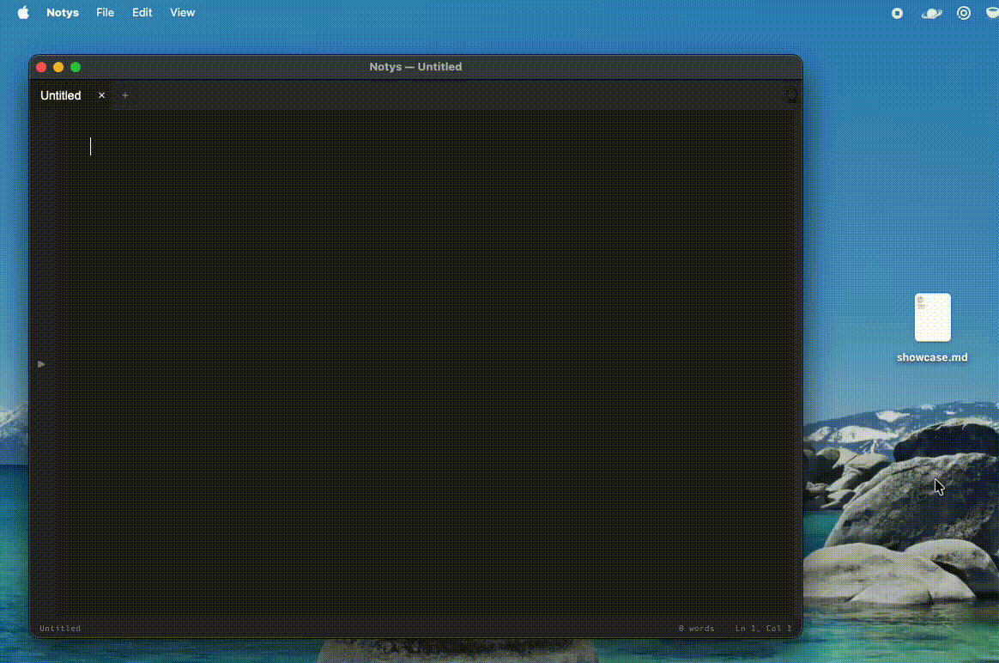

# Notys

Notys is an ultra-lightweight note-taking application designed for speed and simplicity.  
No bloat, just the essential features you need to get your thoughts down.
*Notys is a personal and small project maintained by only one person (me). There is no release schedule, updates are released whenever the time and circumstances allow it.*

## Download
The latest version of Notys (v1.9.2) is currently available for:

**Linux:**

*While it is technically working on Linux OSs, it is not well integrated and is pretty ugly.*
- AppImage (Recommended, see "Get started" for more information)
- .zip and run in the .venv
- Source code (be sure to have downloaded python-tk (arch) or python3-tk (ubuntu) and run `python3 -m pip install --upgrade pip --break-system-packages && python3 -m pip install -r requirements.txt pyinstaller --break-system-packages && python3 -m PyInstaller Notys.spec`)

**Windows:**

- Windows .zip in the release sections 
- Source code

**macOS (Intel and ARM)**:

- .zip to extract the .app file
- .dmg for regular and common app installation method
- Source code (to use the source code, you will need the build env (available in every notys release) and [Python 3.12](https://www.python.org/ftp/python/3.12.4/python-3.12.4-macos11.pkg) and to activate the .venv with `source .venv/bin/activate` or if you don't want to activate the .venv `python3 -m pip install --upgrade pip && python3 -m pip install -r requirements.txt pyinstaller`)

## Features (Markdown-style)

Notys supports real-time formatting using a simple and intuitive syntax:

- **Headers:** Up to 4 levels (using `#`)

- **Bold:** `**text**`

- **Italic:** `*text*`

- **Code Blocks:** `````code`````

- **Text Coloration:** Using the `&^color text^&` syntax.

- **Strikethrough:** `~~strikethrough~~`

- **Highlight:** `==highlight==`

- **Underline**: using ```-: and :-```

- **Link**: using `[google](google.com)` you can create a link.

- **Drag & Drop:** Simply drop files into the app to open them instantly.

- **Languages**: There is support for French, Esperanto and English (English by default) and more!

- **Settings**: Various settings for customization and more.
  
  

  

---

### What's behind the scenes?
Behind the scenes, Notys uses simple and lightweight technologies to do what it does.
It is built with Python, Tkinter (for the main window and some utilities), tkinterdnd2 (drag n drop support), Pillow (image/icon management), and JSON (to save the settings even when you restart the app).

Notys has been built mainly with the help of AI (such as Gemini, Claude, Copilot in GitHub and ChatGPT). I (human) test it manually, imagine features and design prompts.

README has been through ChatGPT to correct typos as I am not an native English speaker.

---

## Getting Started

### For macOS (Intel and now ARM thanks to Rosetta2!)
1. Go to the **Releases** section on GitHub and navigate to the latest version.
2. Download the latest `Notys-macOS-x.x.x.zip`.
3. Unzip and move `Notys.app` to your **Applications** folder.
4. Open the app
5. Have fun!

### For Linux
1. Go to the **Releases** section on GitHub and navigate to the latest release available.
2. Download the Notys-linux-x.x.x-x86_64.zip
3. Run the executable.

### For Windows

1. Go to the **Releases** section on github and navigate to the latest release available.
2. Download the Notys-windows-x.x.x.zip (if it isn't here, just wait i'll be compiling it soon enough)
3. Extract the zip and place the Notys.exe and the _interal folder in the same parent folder (the .exe needs it to execute)
4. Run the .exe file

## Work in Progress (Roadmap)
### Planned for v1.9.0:
- [ ] Date and time timestamps
- [ ] "Format" menu in the menu bar
- [ ] Add a mission-control-ish overview
### Planned in the near or far future:
- [ ] HTML/PDF exporting
- [X] Liquid glass, maybe for 2.0.0
- [X] macOS ARM Support, for 2.0.0
- [X] Switch to SwiftUI+Swift, for 2.0.0. SIKE! I'm going with Rust and Slink for the next Beta.

## Known bugs
### Minor Bugs
- [X] **Keyboard shortcut:** The "Save All" and "Reopen Last Closed" keyboard shortcuts do not work, use the menu bar instead.
- [ ] **Light/Dark Theme Button**: The dark/light theme button in the tab bar doesn't display the right icon if started in light mode. Still completely usable at 100%. Just a UI bug.
